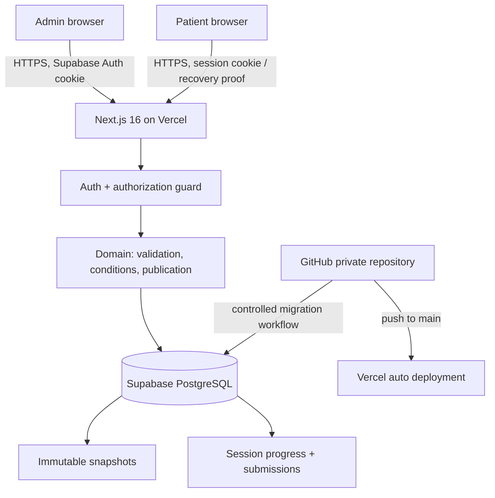

# Bask Health Intake Studio — Phase 1 Architecture

**Date:** 2026-10-10  
**Status:** Architecture proposal documented; implementation NOT started  
**Canonical tracker:** `CHECKLIST.md`  
**Phase mapping:** Phase 1 = architecture in this conversation; the older checklist's "Phase 0 — Architecture" maps to this phase. Foundation becomes Phase 2.

## 1. Decisions / ADRs

| ID      | Decision                                                                                                                                                   | Status   | Why / caveat                                                                                                                                                                                                                                     |
| ------- | ---------------------------------------------------------------------------------------------------------------------------------------------------------- | -------- | ------------------------------------------------------------------------------------------------------------------------------------------------------------------------------------------------------------------------------------------------ |
| ADR-001 | One Next.js 16 App Router modular monolith, TypeScript strict, Tailwind, Polaris icons                                                                     | Proposed | Minimizes operational complexity; feature/domain boundaries avoid spaghetti.                                                                                                                                                                     |
| ADR-002 | Supabase hosted Postgres + Supabase Auth for private admins; Vercel hosting                                                                                | Proposed | Meets hosted persistence and admin auth requirements.                                                                                                                                                                                            |
| ADR-003 | Server-only privileged database access through Drizzle ORM + `postgres` driver, migrations in repo                                                         | Proposed | Type-safe SQL and transaction control; central authorization checks. Supabase Auth verifies identity; app enforces workspace membership on EVERY privileged operation. Use runtime compatible with pooled connection; no browser DB credentials. |
| ADR-004 | No Redis initially                                                                                                                                         | Proposed | Postgres CAS, locks, unique constraints and transactions meet assessed requirements. Reassess only with evidence.                                                                                                                                |
| ADR-005 | Draft content and theme JSONB aggregate with integer revision; immutable publication snapshots                                                             | Proposed | Atomic draft edits, stable historic rendering, flexible field schema. Zod validates JSON at boundaries.                                                                                                                                          |
| ADR-006 | Workspace-level role-based authorization, `owner` and `editor`; reviewer credentials are private                                                           | Proposed | Supports multi-admin without treating login as authorization. Both roles can edit/publish; owner manages invitations if implemented.                                                                                                             |
| ADR-007 | Two-admin edit: optimistic concurrency; one update succeeds, second receives 409 and explicit resolution                                                   | Proposed | No silent last-write-wins; realtime coediting and WebSockets out of scope.                                                                                                                                                                       |
| ADR-008 | Published versions frozen with DB trigger forbidding UPDATE/DELETE; stable unique URL slug                                                                 | Proposed | Old patient sessions always use original form and theme.                                                                                                                                                                                         |
| ADR-009 | Patient sessions pinned to published version; token hash and HttpOnly cookie; cross-browser recovery through user-held high-entropy one-time recovery code | Proposed | No external email required; code is displayed once and must be saved by patient. Add rate limiting, code rotation, and same-session ownership proof. UX burden is a tradeoff to document.                                                        |
| ADR-010 | Exactly-once submission per patient session via row lock, transaction, unique session_id and immutable submission table                                    | Proposed | Lost response/retry returns same outcome; completed responses never change.                                                                                                                                                                      |
| ADR-011 | Vitest, Postgres integration tests, Playwright desktop/mobile, GitHub Actions CI                                                                           | Proposed | Tests start with domain rules and security, not only UI.                                                                                                                                                                                         |
| ADR-012 | GitHub main branch auto-deploys to Vercel production; pull requests receive previews; migrations are controlled                                            | Proposed | Avoid unsafe migrations run by every preview build; GitHub Action migration job gated by approval/production workflow.                                                                                                                           |

**Decision gate:** These are implementation recommendations, not completed features. Check docs and current provider limits/compatibility during setup. Finalize patient recovery-code UX and repository name before irreversible production setup.

## 2. System / trust boundaries



- Admin pages are protected server-side. Authorization always checks authenticated user membership **and** workspace/form ownership; never trust client-provided workspace IDs.
- Public patient routes only read published snapshots, not drafts. Patient operations require a valid capability credential associated with that specific session.
- All privileged database operations originate on the server. Database connection secrets and Supabase service role (if needed at all) stay server-only.
- API responses, cache policy and application logs must avoid disclosing answers, session secrets, or admin data. Set `Cache-Control: private, no-store` for sensitive endpoints.

## 3. Data model - first migration target

Use UUID primary keys, `timestamptz`, `NOT NULL`, FK constraints, timestamps and suitable indexes. Naming suggestions:

### `workspaces`

`id`, `name`, `created_at`.

### `admin_memberships`

`workspace_id`, `user_id` (FK to `auth.users.id` where practical), `role` enum owner/editor, `created_at`, `revoked_at`. Unique active membership `(workspace_id, user_id)`; enforce at service layer and/or partial unique index. Auth identities managed by Supabase Auth.

### `forms`

`id`, `workspace_id`, `name`, `latest_published_version_number` default 0, `created_by`, `created_at`, `updated_at`, `archived_at`. Form deletion after publication is **archive**, never cascade historical data. `name` is admin-facing identity, not historical patient label.

### `form_drafts`

`id`, `form_id` UNIQUE (one current editable draft per form), `definition_json` JSONB, `theme_json` JSONB, `revision` bigint >=0, `updated_by`, `created_at`, `updated_at`, `deleted_at`. To meet "create/open/rename/delete unpublished drafts", create a form with one draft; an already published form can have a new draft for vN+1. Draft deletion of unpublished form may remove form; published forms only archive their current edit draft or form, preserving snapshots.

### `published_versions`

`id`, `form_id`, `version_number`, `public_slug` UNIQUE, `definition_snapshot` JSONB, `theme_snapshot` JSONB, `draft_revision`, `published_by`, `published_at`, `publish_operation_id` UUID UNIQUE. Unique `(form_id,version_number)`. Use DB trigger to reject UPDATE/DELETE (including accidental admin edits); disallow cascading deletion from form. Slug must be random, unguessable enough to avoid enumeration but is a public identifier, **not an auth secret**.

### `patient_sessions`

`id`, `published_version_id`, `status` in (`in_progress`,`completed`), `answer_json` JSONB, `revision` bigint >=0, `credential_hash`, `recovery_hash`, `recovery_expires_at`, `created_at`, `updated_at`, `completed_at`, `expires_at`. `credential_hash` / `recovery_hash` are HMAC or Argon2 hashes as appropriate; constant-time checking where relevant. Consider separate credentials table for rotation/history. Prevent changing `published_version_id` after insert.

### `submissions`

`id`, `session_id` UNIQUE, `published_version_id`, `answer_snapshot` JSONB, `submitted_at`. One immutable row per completed session. Prevent UPDATE/DELETE except explicit audited retention process; FK references are restrictive.

### `publication_operations` (recommended)

`operation_id` UUID PRIMARY KEY, `form_id`, `draft_revision`, `published_version_id` UNIQUE, `created_at`. Used to make a timed-out publish retry return the already created version.

### `audit_events` (non-PHI metadata only)

`id`, `workspace_id`, `actor_user_id`, `event_type`, `entity_id`, `occurred_at`, `metadata_json`. Never log answer bodies, cookies, recovery codes, or session credentials.

**Migration requirements:** unique constraints, check constraints, indexes on `form_id`, `workspace_id`, `published_version_id`, `submitted_at`; retention-aware RESTRICT FKs; triggers for immutable publications/submissions; version number allocation under lock; defensive JSON size limits. Supabase RLS: decide and explicitly document a single privilege path. With server-only Drizzle DB credentials, ensure app auth checks and DB grants are locked down; never expose privileged credentials to browser. If using Supabase clients for user-facing DB operations, RLS must be designed and tested separately.

## 4. Canonical form definition contract

```ts
// Illustrative shape, not implementation code.
type FieldType =
  | "short_text"
  | "long_text"
  | "number"
  | "single_select"
  | "multi_select"
  | "checkbox";
type Visibility = { parentQuestionId: string; equalsOptionId: string } | null;
type Question = {
  id: string; // UUID, never derived from labels/position
  type: FieldType;
  label: string;
  description?: string;
  required: boolean;
  visibility: Visibility;
  validation?: {
    minLength?: number;
    maxLength?: number;
    min?: number;
    max?: number;
    integerOnly?: boolean;
  };
  options?: Array<{ id: string; label: string }>;
};
type FormDefinition = {
  schemaVersion: 1;
  title: string;
  questions: Question[];
};
```

- Persist choices and conditions by IDs, not by labels/index. Single/multi-select need >=2 nonblank distinct normalized option labels before publish.
- A conditional child points to an **earlier required unconditional single-select** parent. Dependency errors are allowed while drafting, blocked on publish.
- Conditions may not nest. Renames preserve relationships, deletes/type changes/reorders expose broken dependencies.
- Pure Zod validators and visibility/answer-pruning functions are shared between preview and server. Server always uses the _published_ snapshot and is authoritative.
- Answer JSON keyed by question ID; select answers contain option IDs. Numeric values use parsed finite JSON numbers, not arbitrary strings.

## 5. Server operation contracts

| Operation                      | Required proof                                                             | Transaction / conflict                                                                                                           | Result                                               |
| ------------------------------ | -------------------------------------------------------------------------- | -------------------------------------------------------------------------------------------------------------------------------- | ---------------------------------------------------- |
| Create/list/rename/delete form | Supabase admin identity + workspace membership                             | Restrict delete after publish                                                                                                    | Authorized form/draft or denial                      |
| Save draft                     | Membership, draft ID, expectedRevision                                     | Compare-and-swap update `WHERE revision = expectedRevision`; 409 on stale                                                        | Revision+persisted snapshot hash / success           |
| Publish                        | Membership, expectedRevision, operationId                                  | Lock `forms`, re-read draft, validate, allocate N+1, insert snapshot, update latest; all in one DB transaction                   | Immutable version + URL; idempotent retry            |
| Create patient session         | Valid published slug                                                       | DB insert with credential hash, version binding                                                                                  | Secure HttpOnly cookie, one-time recovery code shown |
| Resume patient session         | Existing cookie or exact session ref + verified high-entropy recovery code | Rotate/revoke credential on recovery; rate-limit                                                                                 | Cookie established for ONLY that session             |
| Save progress                  | Session credential, expectedSessionRevision                                | Lock/CAS, parse and sanitize against pinned snapshot, strip hidden answers                                                       | New revision and canonical visible answers           |
| Submit                         | Session credential                                                         | Lock session; if completed return prior submission; else canonical prune + final validation + insert and complete in transaction | Same submission ID for all valid retries             |
| List/read responses            | Authenticated membership                                                   | Read-only scoped queries, paged                                                                                                  | Historic labels via pinned snapshot                  |

**Patient resume tradeoff:** On starting the intake, show a one-time recovery code with an explicit "Save this code to continue on another device" control. Resume requires session reference + recovery code; the reference alone grants no access. Use nonsequential session references and high-entropy secrets, protect attempts (DB-backed attempts/cooldown or platform controls), rotate credential on redemption, and avoid embedding answers or secrets in URLs. An email OTP alternative is acceptable if a verified delivery channel is implemented; do not assume email address alone proves ownership.

## 6. Important race/edge scenarios

1. Admin A and B read revision 4; both save -> one revision 5, one HTTP 409; losing client retains unsaved edits and can compare/copy/reapply.
2. Draft edit and publish race -> publish transaction checks expected revision and serializes; inconsistent snapshots impossible.
3. Duplicate publish requests share `operationId` -> return same version; two distinct publish attempts allocate unique numbers serially. Decide UX whether publishing unchanged content again is allowed; default request must be explicit.
4. Network save responses arrive out of order -> client never replaces newer local state; response acknowledgement tied to mutation generation/revision.
5. Conditional Yes -> No -> Yes -> clear now-hidden dependent answer at server and client; when shown again, blank.
6. Client directly sends hidden/unknown option answers -> hidden answers stripped; invalid visible values rejected; never accepted in submission.
7. Patient opens v1; admin publishes v2 -> v1 remains stable for entire session and response presentation.
8. Two patient tabs save same revision -> stale writer receives 409; no silent clobber.
9. Two submissions at once -> session lock + UNIQUE(session_id) -> one row; all retries return same immutable submission, even if payloads differ.
10. Unauthenticated public user requests admin response -> 401/403; editor from workspace A attempts form B -> 403/404.
11. Session reference leaked without code/cookie -> cannot read/change responses.
12. Offline draft edit, browser refresh -> only last successful DB save is guaranteed; show explicit pending local changes and warning before leave. Optional ephemeral local memory not source of truth.
13. Delete parent field/options -> invalid dependency retained for admin repair; cannot publish broken form.
14. Versioned theme changes -> only new published snapshot gets new colors; patients can toggle light/dark, not select presets.
15. Strict, browser-bypass number validation (NaN/Infinity/fractional/bounds); whitespace-only required text; duplicate/unknown multi-select IDs.

## 7. GitHub -> Vercel -> Supabase delivery and environments

- Private repo: `KaranBaskHealth` **if that is the intended FirstNameBaskHealth**, confirm before creating.
- Branches: protected `main` -> Vercel Production auto deployment; PR branches -> Vercel Preview auto deployment. Review environment variables per Vercel environment and ensure previews NEVER point to production patient data.
- One hosted Supabase project for production; prefer separate dev/test project or local Supabase for development/integration. No production data in tests.
- GitHub Actions: lint, `tsc --noEmit`, unit tests, integration tests against disposable/local test Postgres, Playwright; build; migrations in explicit/gated production job before main production release, backward-compatible changes first. Vercel Git integration owns deployment (do not double deploy through Actions).
- Environment variable names (examples): `NEXT_PUBLIC_SUPABASE_URL`, `NEXT_PUBLIC_SUPABASE_ANON_KEY` (or new publishable key name), `SUPABASE_SERVICE_ROLE_KEY` only if strictly needed, `DATABASE_URL` server only, `DATABASE_DIRECT_URL` for migrations, `SESSION_HMAC_KEY`, `APP_URL`, `E2E_BASE_URL` for tests. Never expose secrets in client or logs; `.env.example` contains only placeholders.
- Use HTTPS, DB TLS with certificate verification/verified provider configuration, managed encryption at rest, secure cookies, `Referrer-Policy`, `no-store` for personal content, dependency scanning and private reviewer credentials.
- Before real patient data: contractual/compliance review (including BAA where required), encryption/key management and rotation review, audit access, breach handling, retention/deletion and consent policy. Demo uses fictional data only.

## 8. Directory proposal

```text
src/
  app/(auth)/login/
  app/(admin)/admin/forms/[formId]/
  app/(patient)/intake/[publishedSlug]/
  app/api/admin/...          # endpoints or Server Actions; one convention
  app/api/patient/...
  features/forms/domain/     # schema, rules, normalization
  features/forms/server/     # auth guard, services, persistence
  features/patients/domain/
  features/patients/server/
  features/themes/
  components/admin/
  components/patient/
  components/ui/
  lib/auth/ lib/db/ lib/security/
db/schema/ db/migrations/
scripts/seed/
tests/unit/ tests/integration/ tests/e2e/
docs/architecture/ docs/evidence/
```

## 9. First delivery acceptance criteria (Phase 1 vs actual code)

- [x] Requirements decomposed into tracker; all primary functional areas mapped.
- [x] Proposed application boundaries, DB entities, publication contracts, concurrency model and GitHub deployment topology documented.
- [x] High-risk edge cases and test categories identified.
- [ ] Team approves ADRs, especially DB access mode and cross-browser recovery UX.
- [ ] Actual repository scaffold, SQL migrations, auth, database policies and functions written.
- [ ] Hosted Supabase/Vercel/GitHub connected and successfully deployed.
- [ ] Unit/integration/E2E tests implemented and run.
- [ ] Evidence/results recorded (logs, trace, CI links, screenshots).

**Next step:** Use `PHASE_1_LOCAL_AI_PROMPT.md` for the local AI to create ADRs/schema/migration proposals and initial foundation after reviewing this file. Mark implementation items done only with tests/evidence, not because code was proposed.
