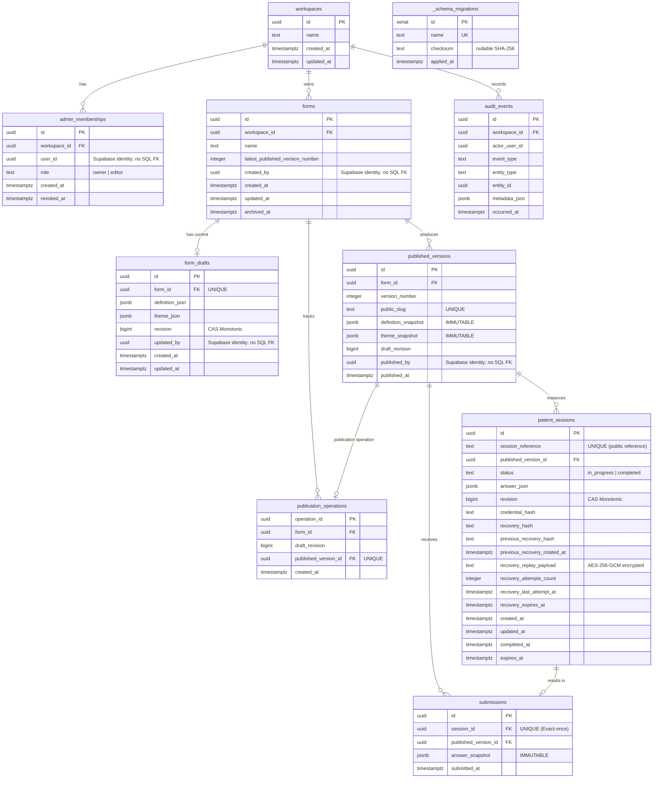

# Database model and metadata audit

Source contracts: [Drizzle schema](../../src/lib/db/schema.ts), [initial migration](../../db/migrations/0001_initial_schema.sql), [RLS/recovery migration](../../db/migrations/0002_enable_rls_and_revoke_grants.sql), and [migration engine](../../scripts/lib/migration-engine.mjs).

On October 11, 2026, both configured URLs resolved to the project listed in the repository's disposable-test allowlist, matching the public Supabase project host. Read-only inspection used the session pooler on port 5432; the application URL uses transaction pooling on port 6543. The target is classified as the repository-designated disposable database. Its relationship to the hosted application requires owner confirmation; these findings do not verify production.

## Tables and columns

Catalog inspection found the nine application tables below plus `_schema_migrations`. Application columns, nullability, foreign-key relationships, and uniqueness match the intended source model. User/actor UUIDs are identity references in application code, not foreign keys to Supabase Auth. No application or Auth records were read.

## Relationships and constraints

All declared foreign keys use ON DELETE RESTRICT. They connect memberships/forms/audit events to workspaces; drafts/versions/publication operations to forms; operations/sessions/submissions to published versions; and submissions to sessions. A draft's UNIQUE(form_id) permits at most one draft at the SQL level; createForm creates one transactionally. No FK ensures that every form has a draft.

| Table                    | Additional uniqueness observed                            |
| ------------------------ | --------------------------------------------------------- |
| `form_drafts`            | `form_id`                                                 |
| `published_versions`     | `(form_id, version_number)` and `public_slug`             |
| `publication_operations` | Primary key `operation_id`; unique `published_version_id` |
| `patient_sessions`       | `session_reference`                                       |
| `submissions`            | `session_id`                                              |
| `_schema_migrations`     | `name`                                                    |

Every table has its diagrammed primary key. `admin_memberships(user_id, workspace_id)` has an index, not a uniqueness constraint. The live migration adds CHECK constraints for owner/editor roles and in_progress/completed status; Drizzle text enum typing alone does not define those SQL checks. The database does not enforce JSON question/option identities or equality between a submission's version and its session's version; services maintain those invariants.

Unique public slugs prevent collisions; the current name/version plus three-random-byte suffix is a public identifier, not a patient access secret. Unpublished forms may be hard-deleted after deleting the draft. Published forms are archived by the service, preserving snapshots/responses; SQL RESTRICT blocks parent deletion while children exist. These are assessment retention choices, not certification of clinical retention compliance.

## Indexes observed

Primary keys and unique constraints have supporting B-tree indexes. Additional indexes are:

| Table                | Index                       | Columns / predicate                                          |
| -------------------- | --------------------------- | ------------------------------------------------------------ |
| `admin_memberships`  | `idx_memberships_user_ws`   | `(user_id, workspace_id)`                                    |
| `forms`              | `idx_forms_workspace`       | `(workspace_id) WHERE archived_at IS NULL`                   |
| `published_versions` | `idx_pub_versions_slug`     | `(public_slug)`                                              |
| `published_versions` | `idx_pub_versions_form_ver` | `(form_id, version_number DESC)`                             |
| `patient_sessions`   | `idx_patient_sessions_ref`  | `(session_reference)`; separate from unique constraint index |
| `patient_sessions`   | `idx_patient_sessions_ver`  | `(published_version_id)`                                     |
| `submissions`        | `idx_submissions_ver_date`  | `(published_version_id, submitted_at DESC)`                  |
| `audit_events`       | `idx_audit_events_ws_time`  | `(workspace_id, occurred_at DESC)`                           |

Migration/live index names and definitions above are authoritative for the inspected database. Drizzle declares `idx_forms_workspace` without the partial predicate, and the version/date indexes without descending order. It omits the redundant session-reference index and uses explicit names for some uniques where migration SQL uses PostgreSQL-generated names. These differences are documented rather than changed during this audit; inspect generated migrations carefully.

## Triggers, RLS, and migration tracking

`trg_protect_published_versions` and `trg_protect_submissions` were enabled (`tgenabled=O`). Their BEFORE UPDATE OR DELETE row functions raise exceptions. This verifies definitions/enabled state, not a mutation test, and does not protect against privileged TRUNCATE or disabling triggers.

All ten tables have RLS enabled, not forced, and no policies. The current `postgres` role owns them and has BYPASSRLS; browser roles have no visible table grants. See [defense in depth](DEFENSE_IN_DEPTH.md) for privilege and transport limits.

The migration engine owns `_schema_migrations`, outside the Drizzle application schema. Its columns are serial `id`, unique non-null `name`, non-null `applied_at`, and nullable `checksum`. Applied entries `0001_initial_schema.sql` and `0002_enable_rls_and_revoke_grants.sql` both match the repository files' SHA-256 checksums. Migration 0002 adds the three nullable recovery replay/previous-credential columns. No migrations or database writes were executed in this audit.
