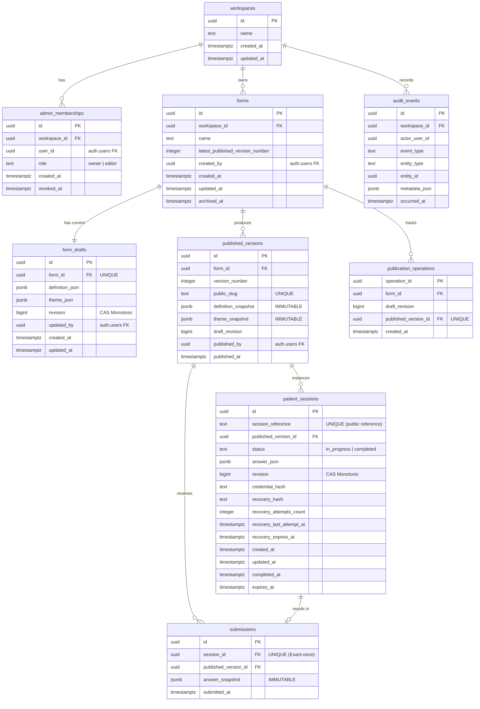

# Entity-Relationship Diagram (ERD) & Database Specification

This document specifies the PostgreSQL data model for **Intake Studio**, implemented via Drizzle ORM and executable SQL migrations.

---

## Mermaid Entity-Relationship Diagram



---

## Relational Constraints & Retention Rules

### 1. Retention & Non-Cascading Deletion

Clinical compliance mandates that patient responses and historical forms cannot be deleted implicitly:

- `forms` table references `workspaces(id)` with `ON DELETE RESTRICT`.
- `published_versions` table references `forms(id)` with `ON DELETE RESTRICT`. Forms with published versions cannot be deleted via SQL `DELETE`; they must be flagged as `archived_at = NOW()`.
- `submissions` references `patient_sessions(id)` and `published_versions(id)` with `ON DELETE RESTRICT`.
- `patient_sessions` references `published_versions(id)` with `ON DELETE RESTRICT`.

### 2. Unique Constraints & Concurrency Indexes

- `published_versions`: `UNIQUE(form_id, version_number)` prevents split-brain duplicate versions.
- `published_versions`: `UNIQUE(public_slug)` guarantees unguessable, one-to-one public URLs.
- `submissions`: `UNIQUE(session_id)` ensures that even if concurrent requests attempt insertion, exactly one row can ever exist for a session.
- `form_drafts`: `UNIQUE(form_id)` ensures one active editable draft aggregate per form.
- `publication_operations`: `UNIQUE(published_version_id)` binds an idempotent publishing ticket to its resultant version snapshot.

### 3. Database Triggers for Absolute Immutability

#### Published Versions Immutability Trigger

```sql
CREATE OR REPLACE FUNCTION prevent_published_version_mutation()
RETURNS TRIGGER AS $$
BEGIN
    RAISE EXCEPTION 'Table published_versions is immutable. UPDATE and DELETE statements are forbidden.';
END;
$$ LANGUAGE plpgsql;

CREATE TRIGGER trg_protect_published_versions
BEFORE UPDATE OR DELETE ON published_versions
FOR EACH ROW EXECUTE FUNCTION prevent_published_version_mutation();
```

#### Submissions Immutability Trigger

```sql
CREATE OR REPLACE FUNCTION prevent_submission_mutation()
RETURNS TRIGGER AS $$
BEGIN
    RAISE EXCEPTION 'Table submissions is immutable. UPDATE and DELETE statements are forbidden.';
END;
$$ LANGUAGE plpgsql;

CREATE TRIGGER trg_protect_submissions
BEFORE UPDATE OR DELETE ON submissions
FOR EACH ROW EXECUTE FUNCTION prevent_submission_mutation();
```

---

## Indexing Strategy

1. **`forms`**:
   - `idx_forms_workspace_id`: Index on `workspace_id` where `archived_at IS NULL` for rapid dashboard listings.
2. **`published_versions`**:
   - `idx_published_versions_slug`: Hash/B-Tree index on `public_slug` for instant public patient resolution.
   - `idx_published_versions_form_ver`: Composite index on `(form_id, version_number DESC)`.
3. **`patient_sessions`**:
   - `idx_patient_sessions_ref`: Unique B-Tree index on `session_reference` for cross-browser lookup.
   - `idx_patient_sessions_version`: Index on `published_version_id` for administrative cohort telemetry.
4. **`submissions`**:
   - `idx_submissions_version_date`: Composite index on `(published_version_id, submitted_at DESC)` for admin response pagination.
5. **`audit_events`**:
   - `idx_audit_events_workspace_time`: Composite index on `(workspace_id, occurred_at DESC)` for security review logs.
