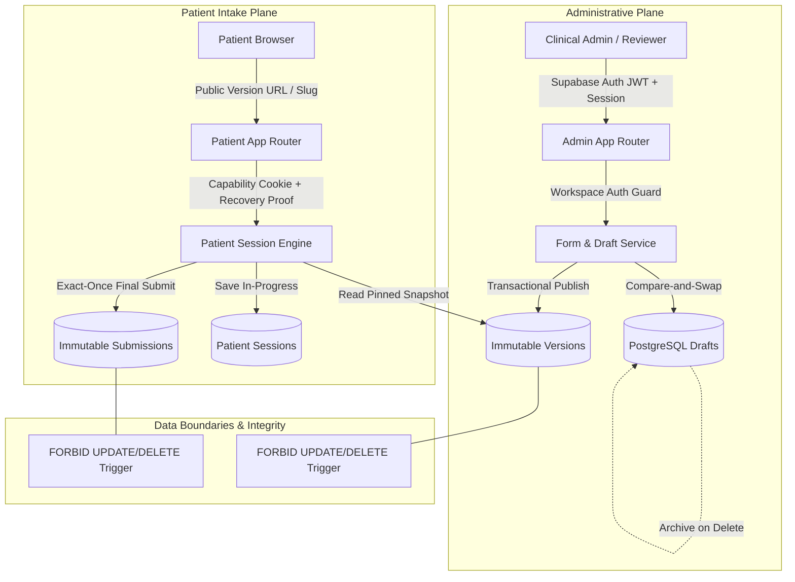

# Intake Studio — Architecture Blueprint

## System Overview

**Intake Studio** is a multi-tenant clinical form builder and patient intake platform designed for high-integrity healthcare workflows. The system decouples administrative authoring from patient execution through **strictly immutable published snapshots**, **optimistic concurrency controls (CAS)**, and **cryptographically verifiable cross-browser patient resumption**.

---

## Architectural Principles

1. **Strict Immutability Over In-Place Mutation**  
   Clinical forms cannot mutate out from under active patients. Publishing clones the draft definition and active theme tokens into an immutable database snapshot identified by a unique public slug and version number. Database triggers actively reject any `UPDATE` or `DELETE` on published snapshots.

2. **Session Pinning to Version Snapshot**  
   Every patient session is irreversibly pinned to a specific `published_version_id` at inception. Even if admins release v2, v3, or archive the parent form, patients in v1 continue rendering v1 questions, options, and theme tokens. Admin responses render against the pinned snapshot at the moment of submission.

3. **No Silent Overwrites (Compare-and-Swap Everywhere)**  
   - **Admin Drafting:** Every write supplies `expectedRevision`. If another administrator committed an intervening edit, the request fails with `HTTP 409 Conflict`, prompting the user to review diffs and resolve without clobbering work.
   - **Patient Progress:** Incomplete session updates supply `expectedSessionRevision` to prevent multiple browser tabs from destroying answers.
   - **Publishing & Submission:** Publications are serial and idempotent via `operationId`; submissions are locked at row level with a strict `UNIQUE(session_id)` constraint ensuring exactly-once execution.

4. **Cryptographic Capability-Based Patient Resume**  
   Patient privacy prohibits requiring external social logins, yet HIPAA concerns forbid exposing answers or persistent access via unauthenticated URLs. Intake Studio implements a dual-credential capability pattern:
   - **Local Browser:** Ephemeral `HttpOnly`, `SameSite=Strict`, `Secure` capability cookie.
   - **Cross-Browser / Device Transfer:** A high-entropy one-time recovery code (`BK-XXXX-XXXX-XXXX`) is issued and displayed to the patient upon session creation. The plaintext is never stored; only an HMAC/Argon2 digest is persisted. Redemption rotates the credential and issues a local cookie after rate-limit verification. Session references alone grant zero read/write capabilities.

5. **Server-Authoritative Validation & Hidden-Field Pruning**  
   Client-side validations exist purely for user feedback. The server evaluates conditional rules against the immutable snapshot. If a parent single-select answer changes from *Yes* to *No*, all dependent answers are pruned immediately both in memory and in the database. Malicious or stale client submissions containing hidden fields or unknown choice IDs are rejected or stripped.

6. **Retention Over Cascading Deletion**  
   Forms with published versions or patient submissions cannot be deleted via cascading foreign keys (`ON DELETE RESTRICT`). Deleting a form archives it, preserving all historical responses and audit logs for compliance.

---

## Document Index

- [Architecture Decision Records (ADRs)](./ADRS.md): Formal record of key technical choices (ADR-001 through ADR-012).
- [Entity-Relationship Diagram & Schema](./ERD.md): Detailed database schema, relationships, triggers, indexes, and constraints.
- [API Contracts & Error Codes](./API_CONTRACTS.md): Full specification of server contracts, validation errors, and CAS protocols.
- [Threat Model & Security Architecture](./THREAT_MODEL.md): STRIDE threat assessment, authentication/authorization boundaries, and PII protection.
- [Edge Cases & Concurrency Deep Dive](./EDGE_CASES.md): Exhaustive analysis of race conditions, reordering hazards, network retries, and failure recoveries.

